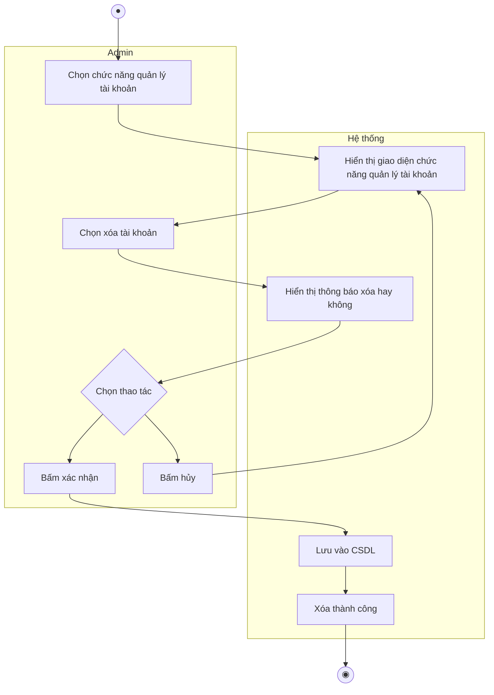
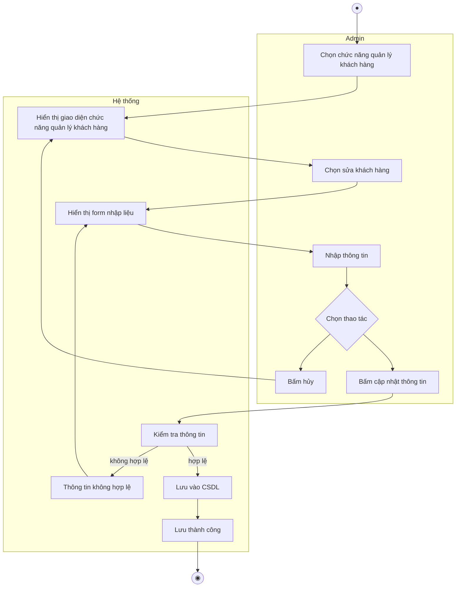
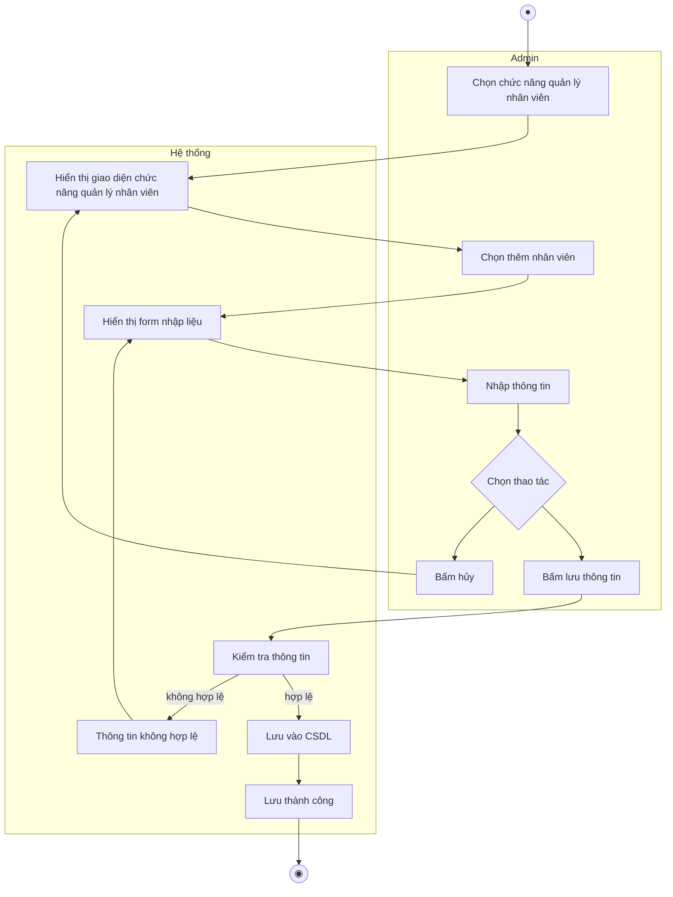
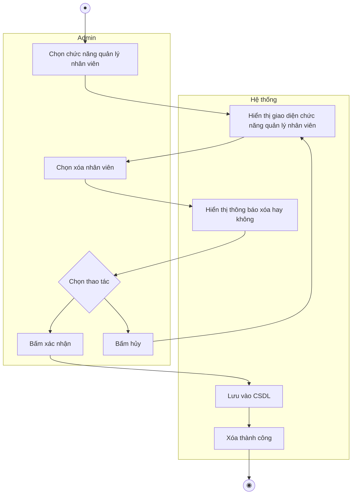
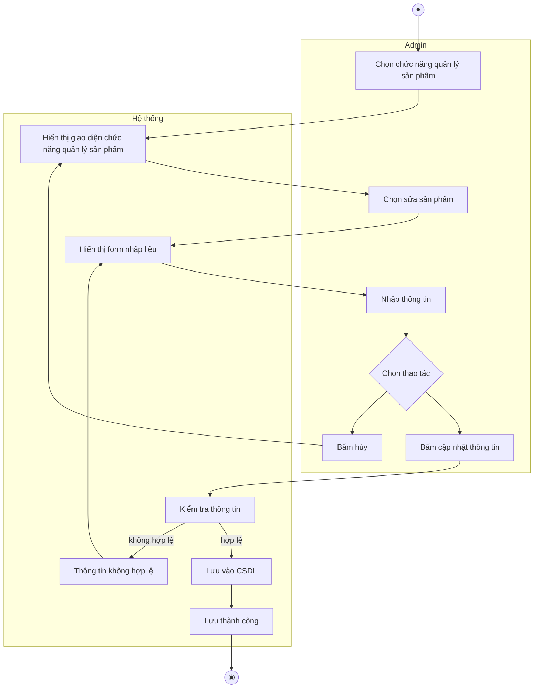
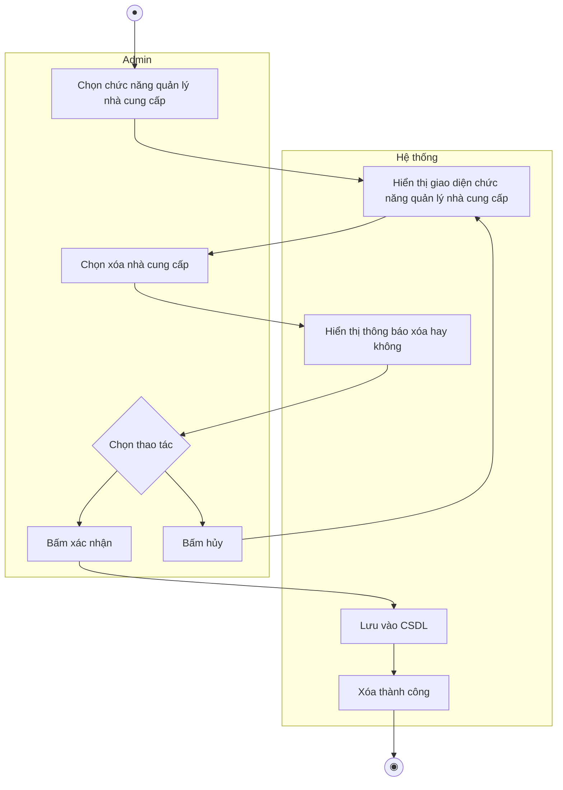

# ĐẶC TẢ USE CASE & BIỂU ĐỒ HOẠT ĐỘNG – VAI TRÒ QUẢN LÝ

## Dự án: Hệ thống Web Bán Rau

> Chuyển từ file `Quản_lí_md.docx` (đặc tả use case + biểu đồ hoạt động) sang Markdown.
> Biểu đồ hoạt động được vẽ lại bằng **Mermaid** (xem được trực tiếp trên GitHub, VS Code, Obsidian...).

**Ghi chú chung**

- **Admin** trong tài liệu này chính là vai trò **Quản lý** (`QuanLy`) ở use case diagram tổng quát.
- Toàn bộ 15 use case đều có Actor là **Admin** và chia làm 5 nhóm: Tài khoản, Khách hàng, Nhân viên, Sản phẩm, Nhà cung cấp.
- Mọi biểu đồ chia 2 làn (swimlane): **Admin** và **Hệ thống**. Thứ tự use case trong mỗi nhóm luôn là **Thêm → Sửa → Xóa**.

---

## Bảng tổng hợp use case

| Mã | Tên use case | Nhóm chức năng | Actor |
|---|---|---|---|
| UC01 | Thêm tài khoản | Quản lý tài khoản | Admin |
| UC02 | Sửa tài khoản | Quản lý tài khoản | Admin |
| UC03 | Xóa tài khoản | Quản lý tài khoản | Admin |
| UC04 | Thêm khách hàng | Quản lý khách hàng | Admin |
| UC05 | Sửa khách hàng | Quản lý khách hàng | Admin |
| UC06 | Xóa khách hàng | Quản lý khách hàng | Admin |
| UC07 | Thêm nhân viên | Quản lý nhân viên | Admin |
| UC08 | Sửa nhân viên | Quản lý nhân viên | Admin |
| UC09 | Xóa nhân viên | Quản lý nhân viên | Admin |
| UC10 | Thêm sản phẩm | Quản lý sản phẩm | Admin |
| UC11 | Sửa sản phẩm | Quản lý sản phẩm | Admin |
| UC12 | Xóa sản phẩm | Quản lý sản phẩm | Admin |
| UC13 | Thêm nhà cung cấp | Quản lý nhà cung cấp | Admin |
| UC14 | Sửa nhà cung cấp | Quản lý nhà cung cấp | Admin |
| UC15 | Xóa nhà cung cấp | Quản lý nhà cung cấp | Admin |

---

## 1. Quản lý tài khoản

### UC01 – Thêm tài khoản

| Mục | Nội dung |
|---|---|
| **Tên UC** | **Thêm tài khoản** |
| **Actor** | **Admin** |
| **Mô tả** | Use case này cho phép Admin thêm một tài khoản mới vào hệ thống thông qua giao diện quản lý tài khoản. |
| **Tiền điều kiện** | 1. Admin đã đăng nhập thành công vào hệ thống với quyền phù hợp. 2. Thiết bị có kết nối mạng. |
| **Luồng sự kiện chính** | 1. Admin chọn chức năng "Quản lý tài khoản". 2. Hệ thống hiển thị giao diện chức năng "Quản lý tài khoản". 3. Admin chọn "Thêm tài khoản". 4. Hệ thống hiển thị form nhập liệu. 5. Admin thực hiện nhập các thông tin cần thiết của tài khoản. 6. Admin bấm "Lưu thông tin". 7. Hệ thống tiến hành kiểm tra tính hợp lệ của thông tin. 8. Thông tin hợp lệ: Hệ thống tiến hành lưu thông tin tài khoản vào cơ sở dữ liệu. 9. Hệ thống thông báo "Lưu thành công" và kết thúc luồng xử lý. |
| **Luồng phụ / Ngoại lệ** | 1. Trường hợp Admin bấm "Hủy": tại bước 6, nếu Admin chọn "Bấm hủy", hệ thống quay trở lại hiển thị giao diện chức năng "Quản lý tài khoản". 2. Trường hợp thông tin không hợp lệ: tại bước 7, hệ thống báo "Thông tin không hợp lệ" và quay lại bước 4 (hiển thị form nhập liệu) để Admin kiểm tra và nhập lại. |

**Biểu đồ hoạt động**

### UC02 – Sửa tài khoản

| Mục | Nội dung |
|---|---|
| **Tên UC** | **Sửa tài khoản** |
| **Actor** | **Admin** |
| **Mô tả** | Use case này cho phép Admin chỉnh sửa, cập nhật thông tin của một tài khoản đã có sẵn trong hệ thống. |
| **Tiền điều kiện** | 1. Admin đang ở giao diện "Quản lý tài khoản". 2. Tài khoản cần sửa đã tồn tại trong hệ thống. 3. Thiết bị có kết nối mạng. |
| **Luồng sự kiện chính** | 1. Admin chọn chức năng "Quản lý tài khoản". 2. Hệ thống hiển thị giao diện chức năng "Quản lý tài khoản". 3. Admin chọn "Sửa tài khoản". 4. Hệ thống hiển thị form nhập liệu. 5. Admin thực hiện nhập/chỉnh sửa thông tin. 6. Admin bấm "Cập nhật thông tin". 7. Hệ thống kiểm tra tính hợp lệ của thông tin vừa sửa. 8. Thông tin hợp lệ → Hệ thống lưu thông tin cập nhật vào cơ sở dữ liệu. 9. Hệ thống thông báo "Lưu thành công". |
| **Luồng phụ / Ngoại lệ** | 1. Tại bước 6, nếu Admin bấm "Hủy", hệ thống quay trở lại hiển thị giao diện chức năng "Quản lý tài khoản". 2. Tại bước 7, nếu thông tin không hợp lệ, hệ thống hiển thị thông báo "Thông tin không hợp lệ" và quay lại bước 4 (hiển thị form nhập liệu). |

**Biểu đồ hoạt động**

### UC03 – Xóa tài khoản

| Mục | Nội dung |
|---|---|
| **Tên UC** | **Xóa tài khoản** |
| **Actor** | **Admin** |
| **Mô tả** | Use case này cho phép Admin xóa một tài khoản khỏi hệ thống. |
| **Tiền điều kiện** | 1. Admin đang ở giao diện "Quản lý tài khoản". 2. Tài khoản cần xóa đã tồn tại trong hệ thống. 3. Thiết bị có kết nối mạng. |
| **Luồng sự kiện chính** | 1. Admin chọn chức năng "Quản lý tài khoản". 2. Hệ thống hiển thị giao diện chức năng "Quản lý tài khoản". 3. Admin chọn "Xóa tài khoản". 4. Hệ thống hiển thị thông báo xóa hay không. 5. Admin bấm "Xác nhận". 6. Hệ thống thực hiện lưu thay đổi vào cơ sở dữ liệu. 7. Hệ thống thông báo "Xóa thành công". |
| **Luồng phụ / Ngoại lệ** | 1. Tại bước 5, nếu Admin bấm "Hủy", hệ thống hủy thao tác xóa và quay trở lại hiển thị giao diện chức năng "Quản lý tài khoản". |

**Biểu đồ hoạt động**

---

## 2. Quản lý khách hàng

### UC04 – Thêm khách hàng

| Mục | Nội dung |
|---|---|
| **Tên UC** | **Thêm khách hàng** |
| **Actor** | **Admin** |
| **Mô tả** | Use case này cho phép Admin thêm một khách hàng mới vào hệ thống. |
| **Tiền điều kiện** | 1. Admin đang ở giao diện "Quản lý khách hàng". 2. Thiết bị có kết nối mạng. |
| **Luồng sự kiện chính** | 1. Admin chọn chức năng "Quản lý khách hàng". 2. Hệ thống hiển thị giao diện chức năng "Quản lý khách hàng". 3. Admin chọn "Thêm khách hàng". 4. Hệ thống hiển thị form nhập liệu. 5. Admin thực hiện nhập thông tin. 6. Admin bấm "Lưu thông tin". 7. Hệ thống kiểm tra tính hợp lệ của thông tin. 8. Thông tin hợp lệ → Hệ thống lưu vào cơ sở dữ liệu. 9. Hệ thống thông báo "Lưu thành công". |
| **Luồng phụ / Ngoại lệ** | 1. Tại bước 6, nếu Admin bấm "Hủy", hệ thống quay trở lại hiển thị giao diện chức năng "Quản lý khách hàng". 2. Tại bước 7, nếu thông tin không hợp lệ, hệ thống hiển thị thông báo "Thông tin không hợp lệ" và quay lại bước 4 (hiển thị form nhập liệu). |

**Biểu đồ hoạt động**

```mermaid
flowchart TB
    st(("●"))
    subgraph ADM["Admin"]
        A1["Chọn chức năng quản lý khách hàng"]
        A2["Chọn thêm khách hàng"]
        A3["Nhập thông tin"]
        D{"Chọn thao tác"}
        A4["Bấm lưu thông tin"]
        A5["Bấm hủy"]
    end
    subgraph SYS["Hệ thống"]
        S1["Hiển thị giao diện chức năng quản lý khách hàng"]
        S2["Hiển thị form nhập liệu"]
        S3["Kiểm tra thông tin"]
        S4["Thông tin không hợp lệ"]
        S5["Lưu vào CSDL"]
        S6["Lưu thành công"]
    end
    fin(("◉"))
    st --> A1
    A1 --> S1
    S1 --> A2
    A2 --> S2
    S2 --> A3
    A3 --> D
    D --> A4
    D --> A5
    A5 --> S1
    A4 --> S3
    S3 -->|"hợp lệ"| S5
    S3 -->|"không hợp lệ"| S4
    S4 --> S2
    S5 --> S6
    S6 --> fin
```

### UC05 – Sửa khách hàng

| Mục | Nội dung |
|---|---|
| **Tên UC** | **Sửa khách hàng** |
| **Actor** | **Admin** |
| **Mô tả** | Use case này cho phép Admin chỉnh sửa, cập nhật thông tin của một khách hàng đã có sẵn trong hệ thống. |
| **Tiền điều kiện** | 1. Admin đang ở giao diện "Quản lý khách hàng". 2. Khách hàng cần sửa đã tồn tại trong hệ thống. 3. Thiết bị có kết nối mạng. |
| **Luồng sự kiện chính** | 1. Admin chọn chức năng "Quản lý khách hàng". 2. Hệ thống hiển thị giao diện chức năng "Quản lý khách hàng". 3. Admin chọn "Sửa khách hàng". 4. Hệ thống hiển thị form nhập liệu. 5. Admin thực hiện nhập/chỉnh sửa thông tin. 6. Admin bấm "Cập nhật thông tin". 7. Hệ thống kiểm tra tính hợp lệ của thông tin. 8. Thông tin hợp lệ → Hệ thống lưu vào cơ sở dữ liệu. 9. Hệ thống thông báo "Lưu thành công". |
| **Luồng phụ / Ngoại lệ** | 1. Tại bước 6, nếu Admin bấm "Hủy", hệ thống quay trở lại hiển thị giao diện chức năng "Quản lý khách hàng". 2. Tại bước 7, nếu thông tin không hợp lệ, hệ thống hiển thị thông báo "Thông tin không hợp lệ" và quay lại bước 4 (hiển thị form nhập liệu). |

**Biểu đồ hoạt động**

### UC06 – Xóa khách hàng

| Mục | Nội dung |
|---|---|
| **Tên UC** | **Xóa khách hàng** |
| **Actor** | **Admin** |
| **Mô tả** | Use case này cho phép Admin xóa một khách hàng khỏi hệ thống. |
| **Tiền điều kiện** | 1. Admin đang ở giao diện "Quản lý khách hàng". 2. Khách hàng cần xóa đã tồn tại trong hệ thống. 3. Thiết bị có kết nối mạng. |
| **Luồng sự kiện chính** | 1. Admin chọn chức năng "Quản lý khách hàng". 2. Hệ thống hiển thị giao diện chức năng "Quản lý khách hàng". 3. Admin chọn "Xóa khách hàng". 4. Hệ thống hiển thị thông báo xóa hay không. 5. Admin bấm "Xác nhận". 6. Hệ thống thực hiện lưu thay đổi vào cơ sở dữ liệu. 7. Hệ thống thông báo "Xóa thành công". |
| **Luồng phụ / Ngoại lệ** | 1. Tại bước 5, nếu Admin bấm "Hủy", hệ thống hủy thao tác xóa và quay trở lại hiển thị giao diện chức năng "Quản lý khách hàng". |

**Biểu đồ hoạt động**

---

## 3. Quản lý nhân viên

### UC07 – Thêm nhân viên

| Mục | Nội dung |
|---|---|
| **Tên UC** | **Thêm nhân viên** |
| **Actor** | **Admin** |
| **Mô tả** | Use case này cho phép Admin thêm một nhân viên mới vào hệ thống. |
| **Tiền điều kiện** | 1. Admin đang ở giao diện "Quản lý nhân viên". 2. Thiết bị có kết nối mạng. |
| **Luồng sự kiện chính** | 1. Admin chọn chức năng "Quản lý nhân viên". 2. Hệ thống hiển thị giao diện chức năng "Quản lý nhân viên". 3. Admin chọn "Thêm nhân viên". 4. Hệ thống hiển thị form nhập liệu. 5. Admin thực hiện nhập thông tin. 6. Admin bấm "Lưu thông tin". 7. Hệ thống kiểm tra tính hợp lệ của thông tin. 8. Thông tin hợp lệ → Hệ thống lưu vào cơ sở dữ liệu. 9. Hệ thống thông báo "Lưu thành công". |
| **Luồng phụ / Ngoại lệ** | 1. Tại bước 6, nếu Admin bấm "Hủy", hệ thống quay trở lại hiển thị giao diện chức năng "Quản lý nhân viên". 2. Tại bước 7, nếu thông tin không hợp lệ, hệ thống hiển thị thông báo "Thông tin không hợp lệ" và quay lại bước 4 (hiển thị form nhập liệu). |

**Biểu đồ hoạt động**

### UC08 – Sửa nhân viên

| Mục | Nội dung |
|---|---|
| **Tên UC** | **Sửa nhân viên** |
| **Actor** | **Admin** |
| **Mô tả** | Use case này cho phép Admin chỉnh sửa, cập nhật thông tin của một nhân viên đã có sẵn trong hệ thống. |
| **Tiền điều kiện** | 1. Admin đang ở giao diện "Quản lý nhân viên". 2. Nhân viên cần sửa đã tồn tại trong hệ thống. 3. Thiết bị có kết nối mạng. |
| **Luồng sự kiện chính** | 1. Admin chọn chức năng "Quản lý nhân viên". 2. Hệ thống hiển thị giao diện chức năng "Quản lý nhân viên". 3. Admin chọn "Sửa nhân viên". 4. Hệ thống hiển thị form nhập liệu. 5. Admin thực hiện nhập/chỉnh sửa thông tin. 6. Admin bấm "Cập nhật thông tin". 7. Hệ thống kiểm tra tính hợp lệ của thông tin. 8. Thông tin hợp lệ → Hệ thống lưu vào cơ sở dữ liệu. 9. Hệ thống thông báo "Lưu thành công". |
| **Luồng phụ / Ngoại lệ** | 1. Tại bước 6, nếu Admin bấm "Hủy", hệ thống quay trở lại hiển thị giao diện chức năng "Quản lý nhân viên". 2. Tại bước 7, nếu thông tin không hợp lệ, hệ thống hiển thị thông báo "Thông tin không hợp lệ" và quay lại bước 4 (hiển thị form nhập liệu). |

**Biểu đồ hoạt động**

### UC09 – Xóa nhân viên

| Mục | Nội dung |
|---|---|
| **Tên UC** | **Xóa nhân viên** |
| **Actor** | **Admin** |
| **Mô tả** | Use case này cho phép Admin xóa một nhân viên khỏi hệ thống. |
| **Tiền điều kiện** | 1. Admin đang ở giao diện "Quản lý nhân viên". 2. Nhân viên cần xóa đã tồn tại trong hệ thống. 3. Thiết bị có kết nối mạng. |
| **Luồng sự kiện chính** | 1. Admin chọn chức năng "Quản lý nhân viên". 2. Hệ thống hiển thị giao diện chức năng "Quản lý nhân viên". 3. Admin chọn "Xóa nhân viên". 4. Hệ thống hiển thị thông báo xóa hay không. 5. Admin bấm "Xác nhận". 6. Hệ thống thực hiện lưu thay đổi vào cơ sở dữ liệu. 7. Hệ thống thông báo "Xóa thành công". |
| **Luồng phụ / Ngoại lệ** | 1. Tại bước 5, nếu Admin bấm "Hủy", hệ thống hủy thao tác xóa và quay trở lại hiển thị giao diện chức năng "Quản lý nhân viên". |

**Biểu đồ hoạt động**

---

## 4. Quản lý sản phẩm

### UC10 – Thêm sản phẩm

| Mục | Nội dung |
|---|---|
| **Tên UC** | **Thêm sản phẩm** |
| **Actor** | **Admin** |
| **Mô tả** | Use case này cho phép Admin thêm một sản phẩm mới vào hệ thống. |
| **Tiền điều kiện** | 1. Admin đang ở giao diện "Quản lý sản phẩm". 2. Thiết bị có kết nối mạng. |
| **Luồng sự kiện chính** | 1. Admin chọn chức năng "Quản lý sản phẩm". 2. Hệ thống hiển thị giao diện chức năng "Quản lý sản phẩm". 3. Admin chọn "Thêm sản phẩm". 4. Hệ thống hiển thị form nhập liệu. 5. Admin thực hiện nhập thông tin. 6. Admin bấm "Lưu thông tin". 7. Hệ thống kiểm tra tính hợp lệ của thông tin. 8. Thông tin hợp lệ → Hệ thống lưu vào cơ sở dữ liệu. 9. Hệ thống thông báo "Lưu thành công". |
| **Luồng phụ / Ngoại lệ** | 1. Tại bước 6, nếu Admin bấm "Hủy", hệ thống quay trở lại hiển thị giao diện chức năng "Quản lý sản phẩm". 2. Tại bước 7, nếu thông tin không hợp lệ, hệ thống hiển thị thông báo "Thông tin không hợp lệ" và quay lại bước 4 (hiển thị form nhập liệu). |

**Biểu đồ hoạt động**

### UC11 – Sửa sản phẩm

| Mục | Nội dung |
|---|---|
| **Tên UC** | **Sửa sản phẩm** |
| **Actor** | **Admin** |
| **Mô tả** | Use case này cho phép Admin chỉnh sửa, cập nhật thông tin của một sản phẩm đã có sẵn trong hệ thống. |
| **Tiền điều kiện** | 1. Admin đang ở giao diện "Quản lý sản phẩm". 2. Sản phẩm cần sửa đã tồn tại trong hệ thống. 3. Thiết bị có kết nối mạng. |
| **Luồng sự kiện chính** | 1. Admin chọn chức năng "Quản lý sản phẩm". 2. Hệ thống hiển thị giao diện chức năng "Quản lý sản phẩm". 3. Admin chọn "Sửa sản phẩm". 4. Hệ thống hiển thị form nhập liệu. 5. Admin thực hiện nhập/chỉnh sửa thông tin. 6. Admin bấm "Cập nhật thông tin". 7. Hệ thống kiểm tra tính hợp lệ của thông tin. 8. Thông tin hợp lệ → Hệ thống lưu vào cơ sở dữ liệu. 9. Hệ thống thông báo "Lưu thành công". |
| **Luồng phụ / Ngoại lệ** | 1. Tại bước 6, nếu Admin bấm "Hủy", hệ thống quay trở lại hiển thị giao diện chức năng "Quản lý sản phẩm". 2. Tại bước 7, nếu thông tin không hợp lệ, hệ thống hiển thị thông báo "Thông tin không hợp lệ" và quay lại bước 4 (hiển thị form nhập liệu). |

**Biểu đồ hoạt động**

### UC12 – Xóa sản phẩm

| Mục | Nội dung |
|---|---|
| **Tên UC** | **Xóa sản phẩm** |
| **Actor** | **Admin** |
| **Mô tả** | Use case này cho phép Admin xóa một sản phẩm khỏi hệ thống. |
| **Tiền điều kiện** | 1. Admin đang ở giao diện "Quản lý sản phẩm". 2. Sản phẩm cần xóa đã tồn tại trong hệ thống. 3. Thiết bị có kết nối mạng. |
| **Luồng sự kiện chính** | 1. Admin chọn chức năng "Quản lý sản phẩm". 2. Hệ thống hiển thị giao diện chức năng "Quản lý sản phẩm". 3. Admin chọn "Xóa sản phẩm". 4. Hệ thống hiển thị thông báo xóa hay không. 5. Admin bấm "Xác nhận". 6. Hệ thống thực hiện lưu thay đổi vào cơ sở dữ liệu. 7. Hệ thống thông báo "Xóa thành công". |
| **Luồng phụ / Ngoại lệ** | 1. Tại bước 5, nếu Admin bấm "Hủy", hệ thống hủy thao tác xóa và quay trở lại hiển thị giao diện chức năng "Quản lý sản phẩm". |

**Biểu đồ hoạt động**

---

## 5. Quản lý nhà cung cấp

### UC13 – Thêm nhà cung cấp

| Mục | Nội dung |
|---|---|
| **Tên UC** | **Thêm nhà cung cấp** |
| **Actor** | **Admin** |
| **Mô tả** | Use case này cho phép Admin thêm một nhà cung cấp mới vào hệ thống. |
| **Tiền điều kiện** | 1. Admin đang ở giao diện "Quản lý nhà cung cấp". 2. Thiết bị có kết nối mạng. |
| **Luồng sự kiện chính** | 1. Admin chọn chức năng "Quản lý nhà cung cấp". 2. Hệ thống hiển thị giao diện chức năng "Quản lý nhà cung cấp". 3. Admin chọn "Thêm nhà cung cấp". 4. Hệ thống hiển thị form nhập liệu. 5. Admin thực hiện nhập thông tin. 6. Admin bấm "Lưu thông tin". 7. Hệ thống kiểm tra tính hợp lệ của thông tin. 8. Thông tin hợp lệ → Hệ thống lưu vào cơ sở dữ liệu. 9. Hệ thống thông báo "Lưu thành công". |
| **Luồng phụ / Ngoại lệ** | 1. Tại bước 6, nếu Admin bấm "Hủy", hệ thống quay trở lại hiển thị giao diện chức năng "Quản lý nhà cung cấp". 2. Tại bước 7, nếu thông tin không hợp lệ, hệ thống hiển thị thông báo "Thông tin không hợp lệ" và quay lại bước 4 (hiển thị form nhập liệu). |

**Biểu đồ hoạt động**

### UC14 – Sửa nhà cung cấp

| Mục | Nội dung |
|---|---|
| **Tên UC** | **Sửa nhà cung cấp** |
| **Actor** | **Admin** |
| **Mô tả** | Use case này cho phép Admin chỉnh sửa, cập nhật thông tin của một nhà cung cấp đã có sẵn trong hệ thống. |
| **Tiền điều kiện** | 1. Admin đang ở giao diện "Quản lý nhà cung cấp". 2. Nhà cung cấp cần sửa đã tồn tại trong hệ thống. 3. Thiết bị có kết nối mạng. |
| **Luồng sự kiện chính** | 1. Admin chọn chức năng "Quản lý nhà cung cấp". 2. Hệ thống hiển thị giao diện chức năng "Quản lý nhà cung cấp". 3. Admin chọn "Sửa nhà cung cấp". 4. Hệ thống hiển thị form nhập liệu. 5. Admin thực hiện nhập thông tin. 6. Admin bấm "Cập nhật thông tin". 7. Hệ thống kiểm tra tính hợp lệ của thông tin. 8. Thông tin hợp lệ → Hệ thống lưu vào cơ sở dữ liệu. 9. Hệ thống thông báo "Lưu thành công". |
| **Luồng phụ / Ngoại lệ** | 1. Tại bước 6, nếu Admin bấm "Hủy", hệ thống quay trở lại hiển thị giao diện chức năng "Quản lý nhà cung cấp". 2. Tại bước 7, nếu thông tin không hợp lệ, hệ thống hiển thị thông báo "Thông tin không hợp lệ" và quay lại bước 4 (hiển thị form nhập liệu). |

**Biểu đồ hoạt động**

### UC15 – Xóa nhà cung cấp

| Mục | Nội dung |
|---|---|
| **Tên UC** | **Xóa nhà cung cấp** |
| **Actor** | **Admin** |
| **Mô tả** | Use case này cho phép Admin xóa một nhà cung cấp khỏi hệ thống. |
| **Tiền điều kiện** | 1. Admin đang ở giao diện "Quản lý nhà cung cấp". 2. Nhà cung cấp cần xóa đã tồn tại trong hệ thống. 3. Thiết bị có kết nối mạng. |
| **Luồng sự kiện chính** | 1. Admin chọn chức năng "Quản lý nhà cung cấp". 2. Hệ thống hiển thị giao diện chức năng "Quản lý nhà cung cấp". 3. Admin chọn "Xóa nhà cung cấp". 4. Hệ thống hiển thị thông báo xóa hay không. 5. Admin bấm "Xác nhận". 6. Hệ thống thực hiện lưu thay đổi vào cơ sở dữ liệu. 7. Hệ thống thông báo "Xóa thành công". |
| **Luồng phụ / Ngoại lệ** | 1. Tại bước 5, nếu Admin bấm "Hủy", hệ thống hủy thao tác xóa và quay trở lại hiển thị giao diện chức năng "Quản lý nhà cung cấp". |

**Biểu đồ hoạt động**

