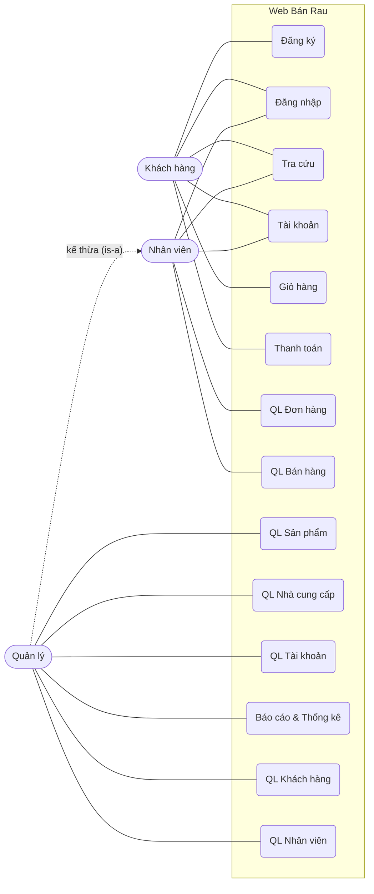
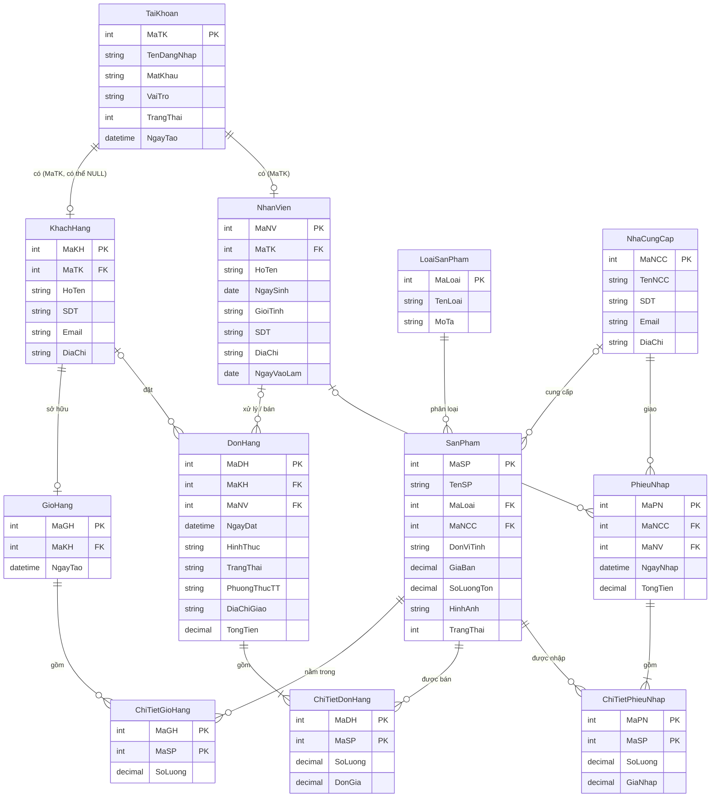
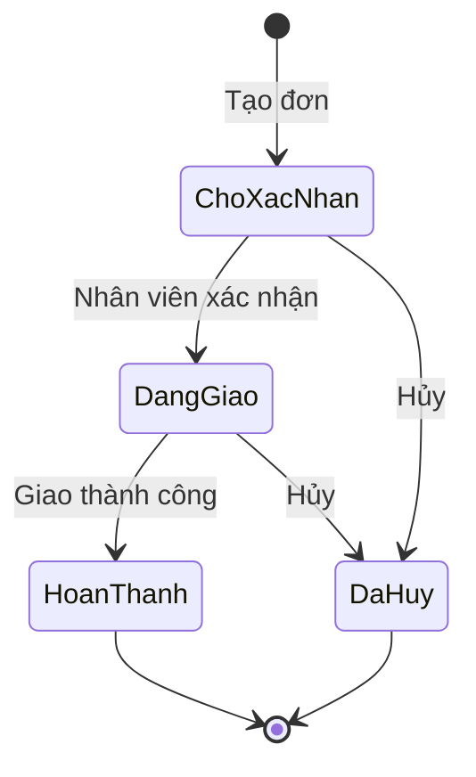

# BÁO CÁO MÔN HỌC: KIẾN TRÚC VÀ THIẾT KẾ PHẦN MỀM

**Tên đề tài: QUẢN LÝ WEB BÁN RAU**

| | |
| --- | --- |
| Trường | Đại học Công nghệ GTVT – Khoa Công nghệ thông tin |
| Giáo viên hướng dẫn | *[điền tên]* |
| Sinh viên thực hiện | *[điền tên, mã sinh viên, nhiệm vụ]* |
| Lớp | *[điền lớp]* |
| Thời gian | *[điền]* |

> **Ghi chú khi dùng bản này:** nội dung được dựng từ (1) CSDL MySQL `web_ban_rau` và (2) biểu đồ Use Case tổng quát của dự án hiện tại, theo cấu trúc 7 chương của báo cáo mẫu *md2*. Những chỗ đánh dấu *(giả định)* là phần mình suy ra hoặc giữ nguyên từ md2 (ví dụ bộ công nghệ Java Spring Boot) – bạn cần kiểm tra lại cho đúng với dự án thật.

---

## Mục lục

- [Chương 1. Giới thiệu và phân tích vấn đề](#chương-1-giới-thiệu-và-phân-tích-vấn-đề)
- [Chương 2. Lựa chọn kiểu kiến trúc](#chương-2-lựa-chọn-kiểu-kiến-trúc)
- [Chương 3. Mô hình hóa kiến trúc (với UML)](#chương-3-mô-hình-hóa-kiến-trúc-với-uml)
- [Chương 4. Thiết kế thành phần và phân tầng chi tiết](#chương-4-thiết-kế-thành-phần-và-phân-tầng-chi-tiết)
- [Chương 5. Áp dụng các mẫu thiết kế](#chương-5-áp-dụng-các-mẫu-thiết-kế-design-patterns)
- [Chương 6. Lựa chọn nền tảng công nghệ và triển khai](#chương-6-lựa-chọn-nền-tảng-công-nghệ-và-triển-khai)
- [Chương 7. Kết luận](#chương-7-kết-luận)
- [Phụ lục. Mã SQL của CSDL](#phụ-lục-mã-sql-của-csdl)

---

# CHƯƠNG 1. GIỚI THIỆU VÀ PHÂN TÍCH VẤN ĐỀ

## 1.1. Mô tả bài toán

### 1.1.1. Giới thiệu

Cùng với sự phát triển của thương mại điện tử, nhu cầu mua thực phẩm tươi sống như rau, củ, quả, nấm qua mạng ngày càng tăng. Người tiêu dùng mong muốn chọn mua nhanh chóng, biết rõ nguồn gốc sản phẩm và có nhiều cách thanh toán, nhận hàng linh hoạt.

Tuy nhiên, nhiều cửa hàng rau vừa và nhỏ vẫn quản lý bằng sổ sách hoặc nhận đơn qua tin nhắn, điện thoại. Cách làm này khó theo dõi tồn kho, dễ nhầm lẫn đơn hàng và khó tổng hợp doanh thu.

Xuất phát từ thực trạng đó, đề tài xây dựng **Hệ thống Web Bán Rau** hỗ trợ đồng thời hai kênh bán hàng: **bán online** (khách đặt qua website) và **bán tại quầy** (nhân viên bán trực tiếp), có quản lý sản phẩm, nhà cung cấp, nhập hàng, tồn kho và báo cáo thống kê. Hệ thống được thiết kế theo kiến trúc MVC *(giả định, giữ nguyên hướng của báo cáo mẫu)* trên nền tảng Java Spring Boot và cơ sở dữ liệu MySQL 8.

### 1.1.2. Thực trạng

Qua mô tả nghiệp vụ của một cửa hàng rau truyền thống, có thể thấy các vấn đề chính:

- **Khó kiểm soát tồn kho:** rau củ nhập/bán với số lượng thập phân (kg, bó), nếu ghi tay dễ sai lệch; không có cảnh báo khi sắp hết hàng.
- **Khó quản lý đơn hàng:** đơn đặt qua điện thoại/mạng xã hội không có trạng thái rõ ràng (chờ xác nhận, đang giao, hoàn thành, đã hủy).
- **Thông tin khách hàng và nhà cung cấp phân tán:** không lưu lịch sử mua hàng, không biết sản phẩm nào đến từ nhà cung cấp nào.
- **Không đồng bộ giữa bán online và bán tại quầy:** hai kênh dùng chung một kho nhưng số liệu tách rời.
- **Giá thay đổi theo thời vụ:** cần lưu giá tại thời điểm bán để báo cáo doanh thu chính xác.
- **Báo cáo doanh thu, sản phẩm bán chạy làm thủ công:** tốn thời gian, dễ sai sót.

### 1.1.3. Giải pháp đề xuất

Xây dựng website bán rau trực tuyến tích hợp các tính năng:

- **Khách hàng mua sắm online:** đăng ký, đăng nhập, tra cứu sản phẩm, thêm vào giỏ hàng, thanh toán và theo dõi tài khoản.
- **Nhân viên xử lý đơn và bán hàng:** tiếp nhận, xác nhận, giao đơn online; lập đơn bán trực tiếp tại quầy.
- **Quản lý toàn bộ hoạt động:** sản phẩm, nhà cung cấp, tài khoản, khách hàng, nhân viên.
- **Tự động cập nhật tồn kho:** bán hàng tự trừ kho, nhập hàng tự cộng kho (thực hiện bằng trigger ở mức CSDL).
- **Báo cáo & thống kê:** doanh thu theo ngày/tháng, sản phẩm bán chạy, cảnh báo tồn kho thấp (thực hiện bằng các view).

## 1.2. Mục tiêu kiến trúc

### 1.2.1. Yêu cầu chức năng

Hệ thống có **3 nhóm người dùng (actor)**, tương ứng 3 giá trị `VaiTro` trong bảng `TaiKhoan`: `KhachHang`, `NhanVien`, `QuanLy`. Trong biểu đồ Use Case, **Quản lý kế thừa toàn bộ chức năng của Nhân viên** (mũi tên từ Quản lý lên Nhân viên) và có thêm các chức năng quản trị.

**Actor 1: Khách hàng (Khách Hàng)**

- **Đăng ký:** tạo tài khoản mới (bảng `TaiKhoan` + `KhachHang`).
- **Đăng nhập:** xác thực để dùng các chức năng được bảo vệ.
- **Tra cứu:** tìm, lọc sản phẩm theo tên, loại.
- **Tài khoản:** xem/cập nhật thông tin cá nhân, địa chỉ giao hàng, theo dõi đơn đã đặt.
- **Giỏ hàng:** thêm, sửa số lượng, xóa sản phẩm trong giỏ.
- **Thanh toán:** đặt hàng và chọn phương thức thanh toán (tiền mặt, chuyển khoản, COD).

**Actor 2: Nhân viên (Nhân Viên)**

- **Đăng nhập** hệ thống với quyền nhân viên.
- **Tra cứu** sản phẩm, thông tin phục vụ bán hàng.
- **Tài khoản:** quản lý thông tin tài khoản cá nhân.
- **QL Đơn hàng:** xem, xác nhận, chuyển trạng thái, hủy đơn hàng online.
- **QL Bán hàng:** lập đơn bán trực tiếp tại quầy (`HinhThuc = 'TaiQuay'`), có thể bán cho khách vãng lai.

**Actor 3: Quản lý (Quản Lý)** – gồm toàn bộ chức năng của Nhân viên, cộng thêm:

- **QL Sản phẩm:** thêm, sửa, ẩn/hiện sản phẩm và loại sản phẩm; cập nhật giá bán.
- **QL Nhà cung cấp:** quản lý thông tin nhà cung cấp (và nhập hàng từ nhà cung cấp).
- **QL Tài khoản:** khóa/mở khóa tài khoản, phân quyền.
- **QL Khách hàng:** xem và quản lý thông tin khách hàng.
- **QL Nhân viên:** thêm, sửa thông tin nhân viên.
- **Báo cáo & Thống kê:** doanh thu theo ngày/tháng, sản phẩm bán chạy, sản phẩm tồn kho thấp.

### 1.2.2. Yêu cầu phi chức năng *(giả định, tham khảo md2)*

| Tiêu chí | Yêu cầu cụ thể | Mức độ ưu tiên |
| --- | --- | --- |
| Hiệu năng | Thời gian phản hồi dưới 3 giây trong điều kiện bình thường; hỗ trợ tối thiểu 50 người dùng đồng thời. | Cao |
| Bảo mật | Mật khẩu lưu dạng hash (BCrypt); phân quyền theo vai trò (RBAC); xác thực bằng JWT; dùng HTTPS. | Rất cao |
| Độ tin cậy | Bảo toàn dữ liệu bằng transaction ACID của MySQL; ràng buộc khóa ngoại, `CHECK` (giá ≥ 0, tồn kho ≥ 0, số lượng > 0); sao lưu định kỳ. | Cao |
| Toàn vẹn dữ liệu | Tồn kho tự động cập nhật khi bán/nhập hàng; đơn giá được lưu tại thời điểm bán. | Cao |
| Khả năng mở rộng | Dễ tích hợp thanh toán online, giao hàng, ứng dụng di động. | Trung bình |
| Khả năng bảo trì | Mã nguồn tổ chức theo Controller – Service – Repository – Model. | Trung bình |
| Tính khả dụng | Giao diện thân thiện, responsive trên desktop và mobile; hỗ trợ tiếng Việt (CSDL dùng `utf8mb4`). | Cao |

## 1.3. Phạm vi hệ thống

| TRONG PHẠM VI (In Scope) | NGOÀI PHẠM VI (Out of Scope) |
| --- | --- |
| Quản lý tài khoản (đăng ký, đăng nhập, phân quyền) | Tích hợp cổng thanh toán trực tuyến (VNPay, Momo) |
| Quản lý sản phẩm và loại sản phẩm | Quản lý đơn vị vận chuyển / theo dõi lộ trình giao hàng |
| Giỏ hàng và đặt hàng online | Chat trực tuyến giữa khách và cửa hàng |
| Bán hàng tại quầy | Quản lý nhiều chi nhánh |
| Quản lý đơn hàng và trạng thái đơn | Ứng dụng di động (mobile app) |
| Quản lý nhà cung cấp và nhập hàng | Chương trình tích điểm, mã khuyến mãi |
| Quản lý khách hàng, nhân viên | Quản lý hạn sử dụng / lô hàng |
| Báo cáo & thống kê (doanh thu, bán chạy, tồn kho thấp) | Tích hợp mạng xã hội |

## 1.4. Các thực thể nghiệp vụ chính

Các thực thể dưới đây lấy trực tiếp từ 12 bảng của CSDL `web_ban_rau`, là nền tảng để xây dựng Class Diagram, Package Diagram và Component Diagram ở Chương 3.

| Thực thể (bảng) | Mô tả | Thuộc tính chính |
| --- | --- | --- |
| Tài khoản (`TaiKhoan`) | Thông tin đăng nhập, dùng chung cho cả 3 vai trò | MaTK, TenDangNhap, MatKhau (hash), VaiTro, TrangThai, NgayTao |
| Khách hàng (`KhachHang`) | Người mua hàng; có thể không có tài khoản (mua tại quầy) | MaKH, MaTK, HoTen, SDT, Email, DiaChi |
| Nhân viên (`NhanVien`) | Nhân viên và quản lý của cửa hàng | MaNV, MaTK, HoTen, NgaySinh, GioiTinh, SDT, DiaChi, NgayVaoLam |
| Nhà cung cấp (`NhaCungCap`) | Đơn vị cung cấp rau củ cho cửa hàng | MaNCC, TenNCC, SDT, Email, DiaChi |
| Loại sản phẩm (`LoaiSanPham`) | Nhóm sản phẩm (Rau ăn lá, Củ, Quả, Nấm…) | MaLoai, TenLoai, MoTa |
| Sản phẩm (`SanPham`) | Mặt hàng đang bán | MaSP, TenSP, MaLoai, MaNCC, DonViTinh, GiaBan, SoLuongTon, MoTa, HinhAnh, TrangThai |
| Giỏ hàng (`GioHang`, `ChiTietGioHang`) | Giỏ hàng của khách (mỗi khách một giỏ) và các dòng sản phẩm trong giỏ | MaGH, MaKH, NgayTao; (MaGH, MaSP, SoLuong) |
| Đơn hàng (`DonHang`, `ChiTietDonHang`) | Đơn bán (online hoặc tại quầy) và các dòng sản phẩm | MaDH, MaKH, MaNV, NgayDat, HinhThuc, TrangThai, PhuongThucTT, DiaChiGiao, GhiChu, TongTien; (MaDH, MaSP, SoLuong, DonGia) |
| Phiếu nhập (`PhieuNhap`, `ChiTietPhieuNhap`) | Phiếu nhập hàng từ nhà cung cấp và các dòng chi tiết | MaPN, MaNCC, MaNV, NgayNhap, TongTien; (MaPN, MaSP, SoLuong, GiaNhap) |
| Báo cáo (4 view) | Dữ liệu thống kê tổng hợp, không phải bảng | `v_doanh_thu_ngay`, `v_doanh_thu_thang`, `v_sp_ban_chay`, `v_ton_kho_thap` |

**Các giá trị liệt kê (ENUM) quan trọng:**

| Trường | Giá trị |
| --- | --- |
| `TaiKhoan.VaiTro` | `KhachHang`, `NhanVien`, `QuanLy` |
| `NhanVien.GioiTinh` | `Nam`, `Nu`, `Khac` |
| `DonHang.HinhThuc` | `Online`, `TaiQuay` |
| `DonHang.TrangThai` | `ChoXacNhan` → `DangGiao` → `HoanThanh` (hoặc `DaHuy`) |
| `DonHang.PhuongThucTT` | `TienMat`, `ChuyenKhoan`, `COD` |

---

# CHƯƠNG 2. LỰA CHỌN KIỂU KIẾN TRÚC

## 2.1. Phân tích yêu cầu kiến trúc

- **Nhiều loại người dùng truy cập đồng thời:** khách hàng, nhân viên, quản lý cùng thao tác, kể cả việc hai kênh (online, tại quầy) cùng trừ một kho.
- **Dữ liệu tập trung và nhất quán:** tồn kho, đơn hàng, giá bán phải đồng bộ tức thời → một CSDL MySQL duy nhất, có transaction.
- **Dễ bảo trì, dễ mở rộng:** tách biệt giao diện, xử lý nghiệp vụ và dữ liệu.
- **Đơn giản, phù hợp phạm vi đồ án:** không cần chia thành nhiều service độc lập.
- **Hỗ trợ Web / RESTful API:** để giao diện (Thymeleaf hoặc React/Vue) giao tiếp với backend, và mở rộng sang mobile sau này.

## 2.2. Kiến trúc MVC được lựa chọn

Hệ thống áp dụng duy nhất kiến trúc **MVC (Model – View – Controller)**.

| Thành phần | Vai trò | Ví dụ trong hệ thống |
| --- | --- | --- |
| Model | Dữ liệu và quy tắc nghiệp vụ; làm việc với MySQL qua Spring Data JPA/Hibernate. | Entity: Account, Customer, Employee, Supplier, Category, Product, Cart, Order, PurchaseReceipt… và các Service tương ứng. |
| View | Giao diện hiển thị dữ liệu và nhận thao tác người dùng. | Trang chủ/tra cứu sản phẩm, giỏ hàng, thanh toán, trang quản lý đơn hàng, quản lý sản phẩm, dashboard báo cáo. |
| Controller | Nhận request HTTP, gọi Service xử lý, trả kết quả (View hoặc JSON). | AuthController, ProductController, CartController, OrderController, SupplierController, ReportController… |

**Luồng xử lý điển hình – khách bấm “Thanh toán”:** View gửi request → `OrderController` → `OrderService` (kiểm tra giỏ, tồn kho, tạo `DonHang` và `ChiTietDonHang`) → Repository ghi vào MySQL (trigger tự trừ tồn kho và cộng `TongTien`) → kết quả trả về Controller → View hiển thị xác nhận.

**Ưu điểm khi chọn MVC:** tách biệt rõ ràng các lớp; nhiều người làm song song; dễ kiểm thử; Spring Boot hỗ trợ MVC sẵn; độ phức tạp thấp, phù hợp quy mô học phần.

## 2.3. Thành phần kiến trúc (C&C View)

| Phân loại | Tên thành phần | Mô tả |
| --- | --- | --- |
| Component (Controller) | AuthController, ProductController, CartController, OrderController, SupplierController, PurchaseController, ReportController | Tiếp nhận request, điều phối Service. |
| Component (Model/Service) | AuthService, ProductService, CartService, OrderService, SupplierService, PurchaseService, ReportService + Entity/Repository | Xử lý nghiệp vụ, thao tác dữ liệu qua JPA. |
| Component (View) | Trang tra cứu, giỏ hàng, thanh toán, quản lý đơn, quản lý sản phẩm, dashboard | Hiển thị và nhận thao tác của 3 nhóm người dùng. |
| Connector | HTTP/REST (JSON) | Giao tiếp giữa View và Controller. |
| Connector | JPA/Hibernate (JDBC) | Cầu nối giữa Service/Repository và MySQL. |

## 2.4. Kết luận chương

Kiến trúc **MVC** được chọn vì: dễ bảo trì, đơn giản gọn nhẹ, tương thích tự nhiên với Spring Boot + MySQL, và đủ mạnh cho các nghiệp vụ bán hàng, nhập hàng, báo cáo của cửa hàng rau. Chương 3 sẽ chuyển các thực thể ở mục 1.4 thành các biểu đồ UML.

---

# CHƯƠNG 3. MÔ HÌNH HÓA KIẾN TRÚC (VỚI UML)

## 3.1. Khung nhìn Logic (Logical View)

### 3.1.0. Biểu đồ Use Case tổng quát

Biểu đồ Use Case của hệ thống “Web Bán Rau” (vẽ lại từ biểu đồ của dự án). Quản lý kế thừa toàn bộ use case của Nhân viên.



### 3.1.1. Biểu đồ lớp (Class Diagram)

Từ các bảng CSDL, các lớp Entity (ánh xạ JPA) được xây dựng như sau:

| Lớp (Class) | Bảng | Thuộc tính chính | Phương thức chính |
| --- | --- | --- | --- |
| Account | TaiKhoan | accountID, username, password, role, status, createdAt | login(), register(), lock(), unlock(), changePassword() |
| Customer | KhachHang | customerID, fullName, phone, email, address | updateProfile(), viewOrders() |
| Employee | NhanVien | employeeID, fullName, birthDate, gender, phone, address, startDate | updateInfo(), processOrder(), sellAtCounter() |
| Supplier | NhaCungCap | supplierID, name, phone, email, address | addSupplier(), updateSupplier() |
| Category | LoaiSanPham | categoryID, name, description | addCategory(), updateCategory() |
| Product | SanPham | productID, name, categoryID, supplierID, unit, price, stockQty, description, image, status | search(), updatePrice(), adjustStock(), hide() |
| Cart | GioHang | cartID, customerID, createdAt | addItem(), updateItem(), removeItem(), clear() |
| CartItem | ChiTietGioHang | cartID, productID, quantity | calculateSubTotal() |
| Order | DonHang | orderID, customerID, employeeID, orderDate, channel, status, paymentMethod, shippingAddress, note, totalAmount | create(), confirm(), ship(), complete(), cancel() |
| OrderItem | ChiTietDonHang | orderID, productID, quantity, unitPrice | calculateSubTotal() |
| PurchaseReceipt | PhieuNhap | receiptID, supplierID, employeeID, receiptDate, totalAmount | create(), calculateTotal() |
| PurchaseItem | ChiTietPhieuNhap | receiptID, productID, quantity, importPrice | calculateSubTotal() |
| ReportService | (4 view) | — | getDailyRevenue(), getMonthlyRevenue(), getBestSellers(), getLowStock() |

**Quan hệ giữa các bảng (ER):**



**Quan hệ giữa các lớp:**

- **Account (1) — (0..1) Customer / Employee:** mỗi tài khoản gắn với tối đa một khách hàng hoặc một nhân viên. Khách mua tại quầy có thể không có tài khoản (`Customer.accountID` = NULL).
- **Customer (1) — (1) Cart:** mỗi khách có một giỏ hàng; **Cart (1) — (n) CartItem** (Composition – xóa giỏ thì xóa chi tiết).
- **Customer (0..1) — (n) Order** và **Employee (0..1) — (n) Order:** đơn hàng có thể của khách vãng lai (NULL) và có nhân viên xử lý.
- **Order (1) — (n) OrderItem** (Composition). **OrderItem** lưu `unitPrice` tại thời điểm bán.
- **Category (1) — (n) Product; Supplier (0..1) — (n) Product.**
- **Supplier (1) — (n) PurchaseReceipt; PurchaseReceipt (1) — (n) PurchaseItem** (Composition).
- **Product (1) — (n) CartItem / OrderItem / PurchaseItem.**
- **ReportService** tổng hợp (Aggregation) dữ liệu từ Order, OrderItem, Product qua các view.

### 3.1.2. Biểu đồ gói (Package Diagram)

| Package | Chứa các lớp/module | Phụ thuộc |
| --- | --- | --- |
| `com.webbanrau.controller` | AuthController, ProductController, CartController, OrderController, SupplierController, PurchaseController, AccountController, ReportController | service, dto |
| `com.webbanrau.service` | AuthService, ProductService, CartService, OrderService, SupplierService, PurchaseService, ReportService | repository, model |
| `com.webbanrau.model` | Account, Customer, Employee, Supplier, Category, Product, Cart, CartItem, Order, OrderItem, PurchaseReceipt, PurchaseItem | — (lõi) |
| `com.webbanrau.repository` | AccountRepository, CustomerRepository, ProductRepository, CartRepository, OrderRepository, PurchaseRepository… (kế thừa JpaRepository) | model, cấu hình MySQL |
| `com.webbanrau.config` | SecurityConfig, JwtConfig, WebMvcConfig | dùng chung |
| `view` (templates / frontend) | Các trang Thymeleaf hoặc React/Vue | controller |

*(Tên package là giả định, bạn đổi theo tên thật của dự án.)*

## 3.2. Khung nhìn Thành phần (Component View)

| Thành phần | Giao diện cung cấp (Provided) | Giao diện yêu cầu (Required) |
| --- | --- | --- |
| AccountComponent | IAuthService (login, register, lock/unlock, getProfile) | IAccountRepository, ICustomerRepository, IEmployeeRepository |
| ProductComponent | IProductService (search, add, update, hide, getByCategory) | IProductRepository, ICategoryRepository, ISupplierRepository |
| CartComponent | ICartService (addItem, updateItem, removeItem, getCart) | ICartRepository, IProductService |
| OrderComponent | IOrderService (checkout, sellAtCounter, confirm, ship, complete, cancel) | IOrderRepository, ICartService, IProductService |
| PurchaseComponent | IPurchaseService (createReceipt, getReceipts) | IPurchaseRepository, ISupplierRepository, IProductService |
| ReportComponent | IReportService (dailyRevenue, monthlyRevenue, bestSellers, lowStock) | Các view v_doanh_thu_ngay, v_doanh_thu_thang, v_sp_ban_chay, v_ton_kho_thap |
| DatabaseComponent | IDataAccess (CRUD chung qua Spring Data JPA) | Kết nối MySQL qua JDBC/Hibernate |

## 3.3. Khung nhìn Triển khai (Deployment View)

| Node | Thành phần được triển khai | Giao thức |
| --- | --- | --- |
| Client (Web Browser / Mobile Browser) | View: giao diện người dùng | HTTPS |
| Application Server (Embedded Tomcat trong Spring Boot, có thể đặt sau Nginx) | Account, Product, Cart, Order, Purchase, Report Component | HTTP/HTTPS, REST (JSON) |
| Database Server (MySQL 8+) | CSDL `web_ban_rau`: bảng, trigger, view | TCP/IP qua JDBC/Hibernate |

Giai đoạn đầu có thể triển khai ứng dụng và MySQL trên cùng một máy; khi tải tăng, tách Database Server và nhân bản ứng dụng sau Load Balancer.

---

# CHƯƠNG 4. THIẾT KẾ THÀNH PHẦN VÀ PHÂN TẦNG CHI TIẾT

## 4.1. Lớp View (Presentation)

| Thành phần giao diện | Đối tượng | Trách nhiệm chính |
| --- | --- | --- |
| Trang đăng ký / đăng nhập | Mọi người dùng | Thu thập thông tin xác thực, báo lỗi định dạng. |
| Trang chủ / Tra cứu sản phẩm | Khách hàng, Nhân viên | Hiển thị danh sách sản phẩm, lọc theo loại, tìm theo tên. |
| Trang giỏ hàng | Khách hàng | Xem, sửa số lượng, xóa sản phẩm trong giỏ. |
| Trang thanh toán | Khách hàng | Nhập địa chỉ giao, chọn phương thức thanh toán, xác nhận đặt hàng. |
| Trang tài khoản | Khách hàng, Nhân viên | Cập nhật thông tin cá nhân, xem lịch sử đơn hàng. |
| Trang quản lý đơn hàng | Nhân viên, Quản lý | Danh sách đơn theo trạng thái, xác nhận / giao / hoàn thành / hủy. |
| Trang bán hàng tại quầy | Nhân viên, Quản lý | Chọn sản phẩm, lập đơn, in/hiển thị tổng tiền. |
| Trang quản lý sản phẩm, nhà cung cấp, nhập hàng | Quản lý | Thêm/sửa/ẩn sản phẩm, quản lý nhà cung cấp, lập phiếu nhập. |
| Trang quản lý tài khoản, khách hàng, nhân viên | Quản lý | Khóa/mở khóa tài khoản, quản lý hồ sơ. |
| Dashboard báo cáo | Quản lý | Biểu đồ doanh thu ngày/tháng, sản phẩm bán chạy, cảnh báo tồn kho thấp. |

View chỉ kiểm tra định dạng dữ liệu đầu vào và hiển thị dữ liệu; **không chứa xử lý nghiệp vụ**.

## 4.2. Lớp Controller – Service (Business)

### 4.2.1. Thực thể nghiệp vụ (Business Entities)

Các Entity ở mục 3.1.1. Một số quy tắc nghiệp vụ đã được đảm bảo ở mức CSDL:

- `GiaBan ≥ 0`, `SoLuongTon ≥ 0`, `SoLuong > 0` (ràng buộc `CHECK`).
- `DonGia` trong `ChiTietDonHang` là **giá tại thời điểm bán**, không đổi khi giá sản phẩm thay đổi.
- Mỗi khách chỉ có một giỏ hàng (`GioHang.MaKH` UNIQUE).
- Mỗi tài khoản chỉ gắn với một khách hàng hoặc một nhân viên (`MaTK` UNIQUE).

### 4.2.2. Luồng công việc (Workflow)

| Workflow | Các bước xử lý chính | Thành phần tham gia |
| --- | --- | --- |
| Đặt hàng online | (1) Khách thêm sản phẩm vào giỏ → (2) Thanh toán: chọn phương thức, nhập địa chỉ → (3) Tạo `DonHang` (Online, `ChoXacNhan`) + `ChiTietDonHang` → (4) Trigger trừ tồn kho, cộng `TongTien` → (5) Xóa giỏ hàng | CartController/Service, OrderController/Service |
| Xử lý đơn online | (1) Nhân viên xem đơn `ChoXacNhan` → (2) Xác nhận, chuyển `DangGiao` → (3) Giao xong chuyển `HoanThanh`; hoặc `DaHuy` | OrderController/Service |
| Bán hàng tại quầy | (1) Nhân viên chọn sản phẩm → (2) Tạo `DonHang` (TaiQuay, `MaKH` có thể NULL) → (3) Trigger cập nhật kho và tổng tiền → (4) Thanh toán tiền mặt/chuyển khoản | OrderController/Service |
| Nhập hàng | (1) Quản lý chọn nhà cung cấp → (2) Tạo `PhieuNhap` + `ChiTietPhieuNhap` → (3) Trigger cộng tồn kho, cộng `TongTien` | PurchaseController/Service |
| Thống kê | (1) Truy vấn các view → (2) Trả dữ liệu cho dashboard | ReportController/Service |

**Vòng đời trạng thái đơn hàng:**



## 4.3. Lớp Model – Repository (Data)

| Thành phần | Trách nhiệm | Công nghệ |
| --- | --- | --- |
| AccountRepository | CRUD tài khoản, tìm theo tên đăng nhập | Spring Data JPA |
| CustomerRepository / EmployeeRepository | CRUD hồ sơ khách hàng, nhân viên | Spring Data JPA |
| ProductRepository | CRUD sản phẩm; tìm theo tên (có index `idx_tensp`), lọc theo loại/trạng thái | Spring Data JPA |
| CartRepository | Lấy giỏ theo khách, CRUD chi tiết giỏ | Spring Data JPA |
| OrderRepository | CRUD đơn hàng, truy vấn theo trạng thái, khách hàng, ngày (có index `idx_ngaydat`) | Spring Data JPA |
| SupplierRepository / PurchaseRepository | CRUD nhà cung cấp, phiếu nhập | Spring Data JPA |
| Trigger & View (MySQL) | `trg_ban_hang`, `trg_nhap_hang` cập nhật kho và tổng tiền; 4 view phục vụ báo cáo | MySQL 8 |

**Trigger trong CSDL:**

- `trg_ban_hang` (sau khi thêm `ChiTietDonHang`): trừ `SanPham.SoLuongTon` và cộng `DonHang.TongTien += SoLuong × DonGia`.
- `trg_nhap_hang` (sau khi thêm `ChiTietPhieuNhap`): cộng `SanPham.SoLuongTon` và cộng `PhieuNhap.TongTien += SoLuong × GiaNhap`.

**View thống kê:**

| View | Nội dung |
| --- | --- |
| `v_doanh_thu_ngay` | Số đơn và doanh thu theo ngày (chỉ đơn `HoanThanh`) |
| `v_doanh_thu_thang` | Doanh thu theo tháng (chỉ đơn `HoanThanh`) |
| `v_sp_ban_chay` | Sản phẩm, tổng số lượng bán, doanh thu – sắp xếp giảm dần |
| `v_ton_kho_thap` | Sản phẩm có tồn kho dưới 10 |

## 4.4. Thành phần xử lý chung (Cross-cutting Components) *(giả định)*

| Thành phần | Chức năng | Áp dụng tại |
| --- | --- | --- |
| An toàn (Security) | Mã hóa mật khẩu (BCrypt), xác thực JWT, phân quyền theo vai trò (KhachHang/NhanVien/QuanLy), chống SQL Injection, CSRF, XSS | Toàn hệ thống |
| Truyền thông (Communication) | Định dạng JSON, xử lý CORS, thông báo khi có đơn mới | View ↔ Controller |
| Quản lý lỗi (Error Handling) | `@ControllerAdvice`/`@ExceptionHandler`, mã lỗi HTTP chuẩn (400, 401, 403, 404, 500), ghi log | Controller, Service |
| Quản lý transaction | `@Transactional` cho các thao tác tạo đơn, nhập hàng để đảm bảo toàn vẹn dữ liệu | Service |

---

# CHƯƠNG 5. ÁP DỤNG CÁC MẪU THIẾT KẾ (DESIGN PATTERNS)

*(Giữ bộ ba Singleton – Strategy – Observer như báo cáo mẫu, được gắn vào nghiệp vụ của cửa hàng rau.)*

## 5.1. Singleton Pattern

- **Áp dụng cho:** `DatabaseConnectionManager` (pool kết nối MySQL) và `AppConfigManager` (cấu hình dùng chung, ví dụ ngưỡng cảnh báo tồn kho – hiện view `v_ton_kho_thap` đang dùng ngưỡng 10).
- **Lý do:** mọi Repository dùng chung một nguồn kết nối; tạo nhiều đối tượng quản lý kết nối gây lãng phí và giảm hiệu năng.
- **Cách hoạt động:** khai báo Spring Bean (mặc định singleton) hoặc lớp có constructor private và `getInstance()`; lần đầu khởi tạo pool (HikariCP), các lần sau trả về cùng một instance.

## 5.2. Strategy Pattern

- **Áp dụng cho:** `PaymentStrategy` – xử lý theo `PhuongThucTT` của đơn hàng.
- **Lý do:** đơn hàng có 3 phương thức thanh toán (`TienMat`, `ChuyenKhoan`, `COD`) với quy trình khác nhau; sau này có thể thêm ví điện tử mà không sửa code cũ.
- **Cách hoạt động:** interface `IPaymentStrategy.pay(Order)` được cài đặt bởi `CashPaymentStrategy`, `BankTransferPaymentStrategy`, `CodPaymentStrategy`. `OrderService` chọn strategy theo phương thức khách chọn và gọi `pay()`. Có thể áp dụng thêm cho chiến lược tính giá (giá thường, giá khuyến mãi theo mùa).

## 5.3. Observer Pattern

- **Áp dụng cho:** thông báo khi trạng thái đơn hàng thay đổi và khi tồn kho xuống thấp.
- **Lý do:** khi đơn chuyển trạng thái (ví dụ `ChoXacNhan` → `DangGiao`) cần đồng thời thông báo cho khách và cập nhật giao diện quản lý; khi tồn kho thấp cần cảnh báo quản lý.
- **Cách hoạt động:** `OrderService` phát sự kiện `OrderStatusChangedEvent` (`ApplicationEventPublisher`); các Listener (`CustomerNotificationListener`, `OrderDashboardListener`, `LowStockListener`) đăng ký bằng `@EventListener` và tự động được kích hoạt.

---

# CHƯƠNG 6. LỰA CHỌN NỀN TẢNG CÔNG NGHỆ VÀ TRIỂN KHAI

*(Phần này giữ theo báo cáo mẫu md2 – nếu dự án dùng công nghệ khác, bạn sửa lại.)*

## 6.1. Ngôn ngữ và Framework

**Java 17 (LTS)** + **Spring Boot 3.2**:

| Tiêu chí | Spring Boot đáp ứng |
| --- | --- |
| Hỗ trợ MVC | Spring MVC tích hợp sẵn (`@Controller`, `@Service`, `@Entity`, `@Repository`). |
| Hỗ trợ REST API | `@RestController` cho giao tiếp JSON với frontend. |
| Design Pattern | Dependency Injection, Spring Bean (singleton), `ApplicationEvent` (observer). |
| Bảo mật | Spring Security, BCrypt, JWT. |
| Truy xuất dữ liệu | Spring Data JPA/Hibernate làm việc với MySQL. |

## 6.2. Môi trường thực thi (Web Server)

Ứng dụng đóng gói thành file `.jar`, chạy trên **Embedded Tomcat**; khi triển khai thật có thể đặt sau **Nginx** (reverse proxy, cân bằng tải). Quản lý dependency bằng **Maven**.

## 6.3. Hệ quản trị cơ sở dữ liệu

**MySQL 8+** (CSDL `web_ban_rau`, bộ ký tự `utf8mb4`, collation `utf8mb4_unicode_ci`):

| Tiêu chí | MySQL 8 |
| --- | --- |
| Dữ liệu quan hệ | 12 bảng với khóa ngoại rõ ràng (mục 3.1.1). |
| Transaction ACID | Đảm bảo toàn vẹn khi tạo đơn, nhập hàng. |
| Logic tại CSDL | Hỗ trợ trigger, view, ràng buộc `CHECK` (MySQL 8.0.16+). |
| Hiệu năng | Có index `idx_tensp` (SanPham.TenSP), `idx_ngaydat` (DonHang.NgayDat). |
| Tiếng Việt | `utf8mb4` hỗ trợ đầy đủ. |

## 6.4. Tổng kết lựa chọn công nghệ

| Hạng mục | Công nghệ |
| --- | --- |
| Ngôn ngữ | Java 17 (LTS) |
| Framework backend | Spring Boot 3.2 (Spring MVC, Spring Data JPA, Spring Security) |
| Kiến trúc phần mềm | MVC |
| Giao tiếp | RESTful API (JSON) |
| Frontend | Thymeleaf hoặc React.js/Vue.js |
| Máy chủ ứng dụng | Embedded Tomcat (+ Nginx tùy chọn) |
| Hệ quản trị CSDL | MySQL 8+ |
| Truy xuất dữ liệu | Spring Data JPA / Hibernate |
| Bảo mật | Spring Security, JWT, BCrypt |
| Build | Maven (NPM nếu tách frontend) |

---

# CHƯƠNG 7. KẾT LUẬN

Báo cáo đã phân tích và thiết kế kiến trúc phần mềm cho **Hệ thống Web Bán Rau**, hỗ trợ cả bán hàng online và bán tại quầy. Các kết quả chính:

- Xác định bài toán, phạm vi, yêu cầu chức năng cho 3 nhóm người dùng (Khách hàng, Nhân viên, Quản lý) và yêu cầu phi chức năng.
- Thiết kế CSDL MySQL gồm 12 bảng, 2 trigger tự động cập nhật tồn kho/tổng tiền và 4 view phục vụ báo cáo.
- Lựa chọn kiến trúc MVC và mô hình hóa bằng UML: Use Case, ER/Class, Package, Component, Deployment.
- Thiết kế chi tiết các lớp View – Controller/Service – Model/Repository và các thành phần xử lý chung.
- Áp dụng các mẫu thiết kế Singleton, Strategy, Observer.
- Đề xuất bộ công nghệ Java Spring Boot + MySQL.

**Hướng phát triển:** tích hợp thanh toán trực tuyến (VNPay, Momo), quản lý giao hàng/đơn vị vận chuyển, khuyến mãi và tích điểm, quản lý lô hàng và hạn sử dụng, ứng dụng di động, nhiều chi nhánh.

---

# PHỤ LỤC. MÃ SQL CỦA CSDL

Toàn bộ mã tạo CSDL `web_ban_rau` (MySQL 8+): bảng, trigger, view và dữ liệu mẫu.

```sql
-- =====================================================
-- CSDL: WEB BÁN RAU  (MySQL 8+)
-- =====================================================
DROP DATABASE IF EXISTS web_ban_rau;
CREATE DATABASE web_ban_rau CHARACTER SET utf8mb4 COLLATE utf8mb4_unicode_ci;
USE web_ban_rau;
-- 1. Tài khoản (Đăng ký / Đăng nhập / QL Tài khoản)
CREATE TABLE TaiKhoan (
    MaTK        INT AUTO_INCREMENT PRIMARY KEY,
    TenDangNhap VARCHAR(50)  NOT NULL UNIQUE,
    MatKhau     VARCHAR(255) NOT NULL,              -- lưu dạng hash (bcrypt...)
    VaiTro      ENUM('KhachHang','NhanVien','QuanLy') NOT NULL DEFAULT 'KhachHang',
    TrangThai   TINYINT(1)   NOT NULL DEFAULT 1,    -- 1: hoạt động, 0: khóa
    NgayTao     DATETIME     NOT NULL DEFAULT CURRENT_TIMESTAMP
);
-- 2. Khách hàng (QL Khách hàng)
CREATE TABLE KhachHang (
    MaKH     INT AUTO_INCREMENT PRIMARY KEY,
    MaTK     INT UNIQUE,                            -- NULL nếu là khách mua tại quầy
    HoTen    VARCHAR(100) NOT NULL,
    SDT      VARCHAR(15),
    Email    VARCHAR(100),
    DiaChi   VARCHAR(255),
    FOREIGN KEY (MaTK) REFERENCES TaiKhoan(MaTK) ON DELETE SET NULL
);
-- 3. Nhân viên (QL Nhân viên) - Quản lý cũng là 1 nhân viên có VaiTro = QuanLy
CREATE TABLE NhanVien (
    MaNV      INT AUTO_INCREMENT PRIMARY KEY,
    MaTK      INT NOT NULL UNIQUE,
    HoTen     VARCHAR(100) NOT NULL,
    NgaySinh  DATE,
    GioiTinh  ENUM('Nam','Nu','Khac'),
    SDT       VARCHAR(15),
    DiaChi    VARCHAR(255),
    NgayVaoLam DATE,
    FOREIGN KEY (MaTK) REFERENCES TaiKhoan(MaTK)
);
-- 4. Nhà cung cấp (QL Nhà cung cấp)
CREATE TABLE NhaCungCap (
    MaNCC   INT AUTO_INCREMENT PRIMARY KEY,
    TenNCC  VARCHAR(150) NOT NULL,
    SDT     VARCHAR(15),
    Email   VARCHAR(100),
    DiaChi  VARCHAR(255)
);
-- 5. Loại sản phẩm
CREATE TABLE LoaiSanPham (
    MaLoai  INT AUTO_INCREMENT PRIMARY KEY,
    TenLoai VARCHAR(100) NOT NULL UNIQUE,           -- Rau ăn lá, Củ, Quả, Nấm...
    MoTa    VARCHAR(255)
);
-- 6. Sản phẩm (QL Sản phẩm / Tra cứu)
CREATE TABLE SanPham (
    MaSP        INT AUTO_INCREMENT PRIMARY KEY,
    TenSP       VARCHAR(150) NOT NULL,
    MaLoai      INT NOT NULL,
    MaNCC       INT,
    DonViTinh   VARCHAR(20)   NOT NULL DEFAULT 'kg',
    GiaBan      DECIMAL(12,2) NOT NULL CHECK (GiaBan >= 0),
    SoLuongTon  DECIMAL(10,2) NOT NULL DEFAULT 0 CHECK (SoLuongTon >= 0),
    MoTa        TEXT,
    HinhAnh     VARCHAR(255),
    TrangThai   TINYINT(1) NOT NULL DEFAULT 1,      -- 1: đang bán
    FOREIGN KEY (MaLoai) REFERENCES LoaiSanPham(MaLoai),
    FOREIGN KEY (MaNCC)  REFERENCES NhaCungCap(MaNCC) ON DELETE SET NULL,
    INDEX idx_tensp (TenSP)
);
-- 7. Giỏ hàng (chức năng của Khách hàng)
CREATE TABLE GioHang (
    MaGH     INT AUTO_INCREMENT PRIMARY KEY,
    MaKH     INT NOT NULL UNIQUE,
    NgayTao  DATETIME NOT NULL DEFAULT CURRENT_TIMESTAMP,
    FOREIGN KEY (MaKH) REFERENCES KhachHang(MaKH) ON DELETE CASCADE
);
CREATE TABLE ChiTietGioHang (
    MaGH     INT NOT NULL,
    MaSP     INT NOT NULL,
    SoLuong  DECIMAL(10,2) NOT NULL CHECK (SoLuong > 0),
    PRIMARY KEY (MaGH, MaSP),
    FOREIGN KEY (MaGH) REFERENCES GioHang(MaGH) ON DELETE CASCADE,
    FOREIGN KEY (MaSP) REFERENCES SanPham(MaSP)
);
-- 8. Đơn hàng (QL Đơn hàng / QL Bán hàng)
--    HinhThuc: 'Online' (khách đặt qua web) hoặc 'TaiQuay' (nhân viên bán trực tiếp)
CREATE TABLE DonHang (
    MaDH        INT AUTO_INCREMENT PRIMARY KEY,
    MaKH        INT,                                -- NULL nếu khách vãng lai
    MaNV        INT,                                -- nhân viên xử lý / bán
    NgayDat     DATETIME NOT NULL DEFAULT CURRENT_TIMESTAMP,
    HinhThuc    ENUM('Online','TaiQuay') NOT NULL DEFAULT 'Online',
    TrangThai   ENUM('ChoXacNhan','DangGiao','HoanThanh','DaHuy') NOT NULL DEFAULT 'ChoXacNhan',
    PhuongThucTT ENUM('TienMat','ChuyenKhoan','COD') NOT NULL DEFAULT 'TienMat',
    DiaChiGiao  VARCHAR(255),
    GhiChu      VARCHAR(255),
    TongTien    DECIMAL(14,2) NOT NULL DEFAULT 0,
    FOREIGN KEY (MaKH) REFERENCES KhachHang(MaKH) ON DELETE SET NULL,
    FOREIGN KEY (MaNV) REFERENCES NhanVien(MaNV)  ON DELETE SET NULL,
    INDEX idx_ngaydat (NgayDat)
);
CREATE TABLE ChiTietDonHang (
    MaDH     INT NOT NULL,
    MaSP     INT NOT NULL,
    SoLuong  DECIMAL(10,2) NOT NULL CHECK (SoLuong > 0),
    DonGia   DECIMAL(12,2) NOT NULL,                -- giá tại thời điểm bán
    PRIMARY KEY (MaDH, MaSP),
    FOREIGN KEY (MaDH) REFERENCES DonHang(MaDH) ON DELETE CASCADE,
    FOREIGN KEY (MaSP) REFERENCES SanPham(MaSP)
);
-- 9. Nhập hàng từ nhà cung cấp (giúp cập nhật tồn kho & báo cáo)
CREATE TABLE PhieuNhap (
    MaPN     INT AUTO_INCREMENT PRIMARY KEY,
    MaNCC    INT NOT NULL,
    MaNV     INT,
    NgayNhap DATETIME NOT NULL DEFAULT CURRENT_TIMESTAMP,
    TongTien DECIMAL(14,2) NOT NULL DEFAULT 0,
    FOREIGN KEY (MaNCC) REFERENCES NhaCungCap(MaNCC),
    FOREIGN KEY (MaNV)  REFERENCES NhanVien(MaNV) ON DELETE SET NULL
);
CREATE TABLE ChiTietPhieuNhap (
    MaPN     INT NOT NULL,
    MaSP     INT NOT NULL,
    SoLuong  DECIMAL(10,2) NOT NULL CHECK (SoLuong > 0),
    GiaNhap  DECIMAL(12,2) NOT NULL,
    PRIMARY KEY (MaPN, MaSP),
    FOREIGN KEY (MaPN) REFERENCES PhieuNhap(MaPN) ON DELETE CASCADE,
    FOREIGN KEY (MaSP) REFERENCES SanPham(MaSP)
);
-- =====================================================
-- TRIGGER: tự trừ / cộng tồn kho
-- =====================================================
DELIMITER $$
CREATE TRIGGER trg_ban_hang AFTER INSERT ON ChiTietDonHang
FOR EACH ROW
BEGIN
    UPDATE SanPham SET SoLuongTon = SoLuongTon - NEW.SoLuong WHERE MaSP = NEW.MaSP;
    UPDATE DonHang SET TongTien = TongTien + NEW.SoLuong * NEW.DonGia WHERE MaDH = NEW.MaDH;
END$$
CREATE TRIGGER trg_nhap_hang AFTER INSERT ON ChiTietPhieuNhap
FOR EACH ROW
BEGIN
    UPDATE SanPham SET SoLuongTon = SoLuongTon + NEW.SoLuong WHERE MaSP = NEW.MaSP;
    UPDATE PhieuNhap SET TongTien = TongTien + NEW.SoLuong * NEW.GiaNhap WHERE MaPN = NEW.MaPN;
END$$
DELIMITER ;
-- =====================================================
-- VIEW cho Báo cáo & Thống kê
-- =====================================================
CREATE VIEW v_doanh_thu_ngay AS
SELECT DATE(NgayDat) AS Ngay, COUNT(*) AS SoDon, SUM(TongTien) AS DoanhThu
FROM DonHang
WHERE TrangThai = 'HoanThanh'
GROUP BY DATE(NgayDat);
CREATE VIEW v_doanh_thu_thang AS
SELECT YEAR(NgayDat) AS Nam, MONTH(NgayDat) AS Thang, SUM(TongTien) AS DoanhThu
FROM DonHang
WHERE TrangThai = 'HoanThanh'
GROUP BY YEAR(NgayDat), MONTH(NgayDat);
CREATE VIEW v_sp_ban_chay AS
SELECT sp.MaSP, sp.TenSP, SUM(ct.SoLuong) AS TongBan, SUM(ct.SoLuong * ct.DonGia) AS DoanhThu
FROM ChiTietDonHang ct
JOIN DonHang dh ON dh.MaDH = ct.MaDH AND dh.TrangThai = 'HoanThanh'
JOIN SanPham sp ON sp.MaSP = ct.MaSP
GROUP BY sp.MaSP, sp.TenSP
ORDER BY TongBan DESC;
CREATE VIEW v_ton_kho_thap AS
SELECT MaSP, TenSP, SoLuongTon FROM SanPham WHERE SoLuongTon < 10;
-- =====================================================
-- DỮ LIỆU MẪU
-- =====================================================
INSERT INTO TaiKhoan (TenDangNhap, MatKhau, VaiTro) VALUES
('admin',  'hash_admin',  'QuanLy'),
('nv01',   'hash_nv01',   'NhanVien'),
('kh01',   'hash_kh01',   'KhachHang');
INSERT INTO NhanVien (MaTK, HoTen, SDT) VALUES
(1, 'Nguyễn Văn Quản', '0900000001'),
(2, 'Trần Thị Nhân',   '0900000002');
INSERT INTO KhachHang (MaTK, HoTen, SDT, DiaChi) VALUES
(3, 'Lê Văn Khách', '0900000003', 'Hà Nội');
INSERT INTO NhaCungCap (TenNCC, SDT, DiaChi) VALUES
('HTX Rau Sạch Mộc Châu', '0911111111', 'Sơn La'),
('Nông trại Đà Lạt',      '0922222222', 'Lâm Đồng');
INSERT INTO LoaiSanPham (TenLoai) VALUES ('Rau ăn lá'), ('Củ'), ('Quả');
INSERT INTO SanPham (TenSP, MaLoai, MaNCC, DonViTinh, GiaBan, SoLuongTon) VALUES
('Rau muống',  1, 1, 'bó', 10000, 100),
('Cải xanh',   1, 1, 'kg', 25000, 80),
('Cà rốt',     2, 2, 'kg', 30000, 60),
('Cà chua',    3, 2, 'kg', 35000, 50);
```
